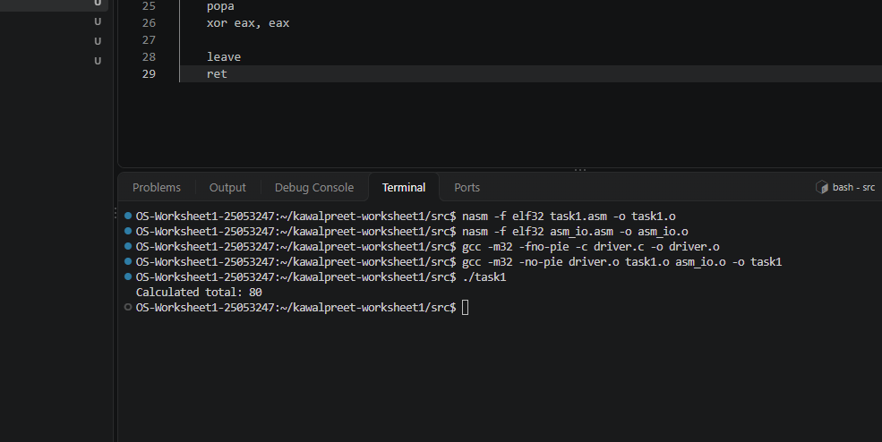
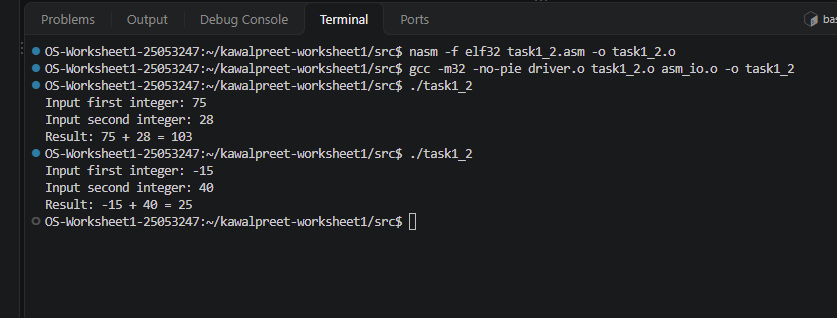
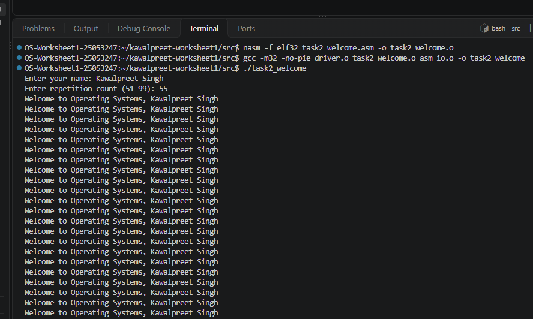
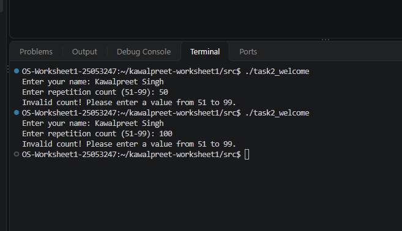
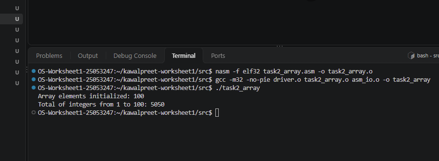
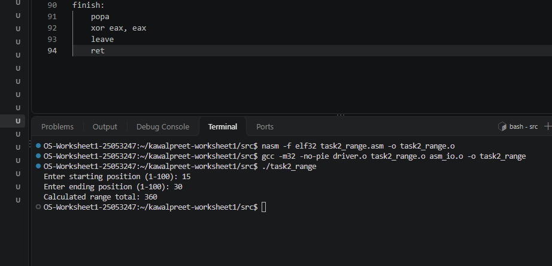
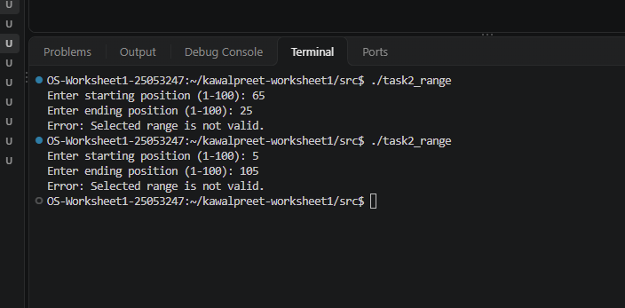
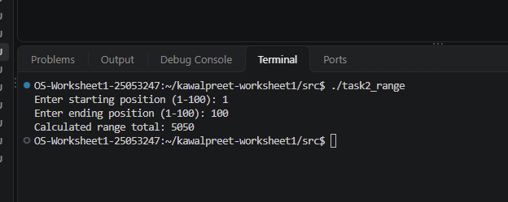
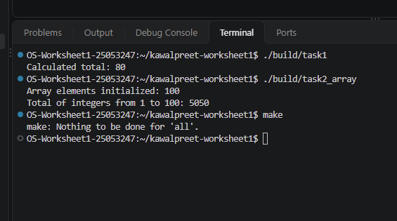

# Worksheet 1 — An Echo of Assembler

| Student information | Details |
|---|---|
| Name | Kawalpreet Singh |
| Student ID | 25053247 |
| Module | UFCFWK-15-2 Operating Systems |
| Environment | Ubuntu on WSL 2 |
| Languages | 32-bit x86 assembly and C |

## 1. Purpose and project organisation

This worksheet explores how a C application can invoke assembly routines, how arithmetic and control flow are expressed using processor instructions, and how GNU Make manages a multi-program build. The five programs are separate executables because each implements its own `asm_main` entry point.

```text
kawalpreet-worksheet1/
├── README.md
├── Makefile
├── .gitignore
├── screenshots/       # Nine execution evidence images
└── src/
    ├── asm_io.asm
    ├── asm_io.inc
    ├── driver.c
    ├── task1.asm
    ├── task1_2.asm
    ├── task2_welcome.asm
    ├── task2_array.asm
    └── task2_range.asm
```

NASM produces ELF32 object files, GCC compiles the C driver and links the objects, and GNU Make automates these operations. VS Code is used for editing and Git for version control. The generated `build/` directory and manually compiled binaries are excluded from version control.

## 2. Task 1 — Arithmetic and C interoperability (20%)

### Shared C interface

The driver declares and calls `asm_main` using the C calling convention:

```c
int __attribute__((cdecl)) asm_main(void);
```

The assembly routines establish a stack frame using EBP, preserve general-purpose registers with `pusha` and restore them with `popa`. Setting EAX to zero before returning supplies the successful return status to C. The supplied `asm_io` library provides console input and output.

### 2.1 Adding global integers (`task1.asm`)

Two initialized double-word variables hold 32 and 48. The CPU loads the first number from memory and adds the second:

```asm
mov eax, [value_a]
add eax, [value_b]
call print_int
call print_nl
```

Square brackets dereference a memory address. The resulting value in EAX is passed to `print_int`. The observed output is `Calculated total: 80`, matching 32 + 48.



*Figure 1. Execution of the global addition program.*

### 2.2 Interactive addition (`task1_2.asm`)

The second program accepts two signed integers using `read_int`. The `.data` section contains prompts and formatting strings, whereas `.bss` reserves storage for the inputs and total. After the second input is read into EAX, the following instructions complete the calculation:

```asm
mov [second_value], eax
add eax, [first_value]
mov [total], eax
```

Saving the result prevents subsequent output calls from replacing it as EAX is reused to supply string addresses and integers to the I/O routines.

| Inputs | Expected result | Reported terminal result |
|---|---:|---:|
| 75, 28 | 103 | 103 |
| -15, 40 | 25 | 25 |



*Figure 2. Positive and negative integer addition tests.*

The program uses signed 32-bit arithmetic; overflow detection is not implemented.

## 3. Task 2 — Control flow and arrays (20%)

### 3.1 Repeated welcome message (`task2_welcome.asm`)

A 64-byte buffer stores the name. Characters are read individually until a newline or end-of-input check terminates the input loop. At most 63 characters are stored, leaving space for the null terminator. The repetition count is then validated using signed comparisons:

```asm
cmp eax, 51
jl invalid_count
cmp eax, 99
jg invalid_count
```

The strict worksheet requirement of greater than 50 and less than 100 is therefore represented by the inclusive interval 51–99. The remaining repetition count is stored in memory. Each iteration prints the greeting and name, then executes:

```asm
dec dword [remaining]
jnz display_welcome
```

The loop stops when the counter becomes zero.

| Test input | Expected behaviour |
|---|---|
| Kawalpreet Singh, 55 | 55 welcome messages and a completion message |
| Kawalpreet Singh, 50 | Invalid count message |
| Kawalpreet Singh, 100 | Invalid count message |



*Figure 3. Welcome-message execution with an accepted count.*



*Figure 4. Rejection of the excluded boundary values.*

### 3.2 Initialising and summing an array (`task2_array.asm`)

The array reserves 100 double words, requiring 400 bytes. Unlike an indexed traversal, this implementation advances a pointer by four bytes for each element. ECX controls the number of iterations.

```asm
fill_array:
    mov [edi], eax
    add edi, 4
    inc eax
    loop fill_array
```

The first loop stores the integers 1 through 100. A separate traversal starts at the array base and accumulates the stored values:

```asm
calculate_total:
    add edx, [esi]
    add esi, 4
    loop calculate_total
```

The `loop` instruction decrements ECX and branches if it is nonzero. EDX holds the total. The independent mathematical check is `100 × 101 / 2 = 5050`.



*Figure 5. Array initialisation and summation evidence.*

### 3.3 Summing a selected range (`task2_range.asm`)

The program populates the same 100-element array and reads two inclusive positions. Before accessing memory, it checks that the lower position is at least 1, the upper position is no greater than 100, and the lower position does not exceed the upper position. Together these conditions ensure both positions are within the array.

The number of elements to process is calculated as `upper - lower + 1`. Since array offsets are zero-based, the lower position is reduced by one before calculating its address:

```asm
mov ecx, ebx
sub ecx, eax
inc ecx
dec eax
lea esi, [values + eax * 4]
```

The summation loop adds the integer addressed by ESI to EDX, advances the pointer by four bytes and repeats for the selected number of elements. Invalid ranges branch to an error message instead of accessing the array.

| Lower | Upper | Expected result |
|---:|---:|---|
| 15 | 30 | 360 |
| 65 | 25 | Error: reversed range |
| 5 | 105 | Error: outside array bounds |
| 1 | 100 | 5050 |

For the first test, there are 16 elements, so the expected total is `16 × (15 + 30) / 2 = 360`.



*Figure 6. Valid partial-range test.*



*Figure 7. Range validation tests.*



*Figure 8. Full-array range test.*

## 4. Task 3 — Automated build (20%)

The root Makefile generates all five executables in `build/`. It shares the C driver and I/O library objects between programs while linking only one program-specific object into each executable.

```makefile
ASFLAGS = -f elf32 -I src/
CFLAGS = -m32 -fno-pie
LDFLAGS = -m32 -no-pie
```

The flags select 32-bit output and non-PIE linking, appropriate for the absolute memory addressing used in these assembly programs.

```makefile
all: $(EXECUTABLES)

$(OUTPUT_DIR)/%.o: $(SOURCE_DIR)/%.asm $(SOURCE_DIR)/asm_io.inc | $(OUTPUT_DIR)
	$(AS) $(ASFLAGS) $< -o $@
```

The pattern rule assembles source files and declares the include file as a dependency. The output directory is an order-only prerequisite, so directory timestamp changes do not alone trigger recompilation. `$<` refers to the first prerequisite, `$@` to the target and `$^` in the link recipe to all regular prerequisites. The phony `clean` target removes the build directory.

### Build and run

From the repository root:

```bash
make clean
make
ls -lh build/
./build/task1
./build/task2_array
```

The other programs can be launched with `./build/task1_2`, `./build/task2_welcome` and `./build/task2_range`. A second `make` without source changes should report that there is nothing to build.



*Figure 9. Compilation and execution using GNU Make.*

## 5. Task 4 — Documentation and verification (40%)

The repository contains the assembly and C sources, the build configuration and nine screenshots. The snippets in this document highlight the essential mechanisms rather than duplicating complete source files.

The arithmetic outputs for Task 1 were recorded in the terminal. For Tasks 2 and 3, the screenshots provide the execution evidence to compare against the expected results documented above. Additional useful checks include repetition counts 51 and 99, the one-element range 100–100, and a range beginning at zero. These additional checks are suggested tests, not claimed execution results.

## 6. Technical conclusions

The programs demonstrate that assembly requires explicit handling of memory addresses, register values, loop counters and conditional branches. The C interface shows how independently compiled languages can communicate using a shared calling convention. The array exercises illustrate the distinction between a value and its address, while range validation protects against out-of-bounds accesses. The Makefile consolidates the build process and makes it reproducible.

## References

- Gaster, B. R. *UFCFWK-15-2 Operating Systems: Worksheet 1 — An Echo of Assembler*. University of the West of England, module worksheet.
- Carter, P. A. *PC Assembly Language*. https://pacman128.github.io/pcasm/
- NASM. *Documentation*. https://www.nasm.us/docs.php
- GNU. *GNU Make Manual*. https://www.gnu.org/software/make/manual/
- GNU. *GCC Documentation*. https://gcc.gnu.org/onlinedocs/
